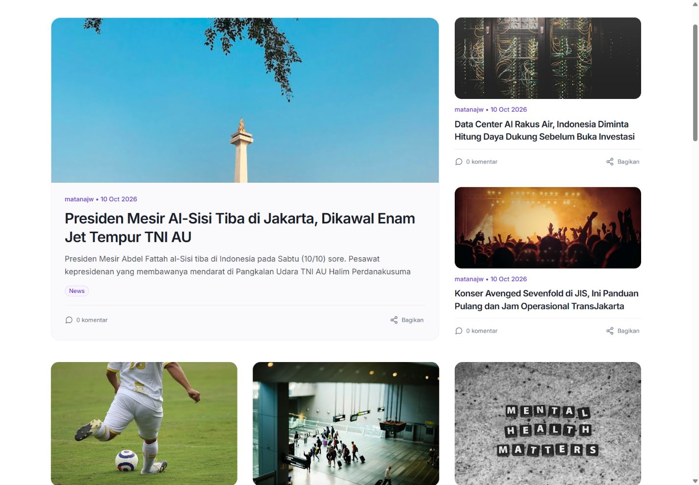

# Spoler Blogger Theme

**Spoler v1.0.3** adalah template Blogger gratis untuk blog dan magazine, dibuat dan dipelihara oleh [TemaBlogger](https://www.temablogger.com/).

[Demo](https://www.landingkilat.com/) · [Unduh ZIP](https://github.com/tema-blogger/Spoler-Blogger-Theme/releases/download/v1.0.3/Spoler-v1.0.3.zip) · [Halaman produk](https://www.temablogger.com/2026/11/spoler-template-blogger-gratis.html)

## Fitur

- Headline satu artikel besar di kiri dan dua artikel kecil di kanan pada desktop.
- Layout responsif untuk beranda, arsip/label, pencarian, artikel, halaman statis dan 404.
- Ikon dan jumlah komentar dari Blogger, serta tautan menuju bagian komentar.
- Menu berbagi WhatsApp, Facebook, X, Telegram, LinkedIn dan salin tautan.
- Komentar native Blogger, menu ponsel, dan indeks berita dengan filter tanggal/topik.
- Footer ringkas berwarna gelap di seluruh halaman, dengan kredit Tema Blogger Free.
- Header/logo dan menu melalui gadget native Blogger; label dan jumlah artikel beranda dapat diatur.
- Gambar headline diprioritaskan, ukuran gambar responsif, serta feed di bawah layar ditunda.
- Font Inter dengan fallback sistem. Tanpa pustaka JavaScript pihak ketiga pada situs publik.
- Gratis, tanpa aktivasi domain atau purchase key.

## Dukung developer

Jika tema ini bermanfaat, beri ⭐ Star pada [repositori ini](https://github.com/tema-blogger/Spoler-Blogger-Theme) dan bagikan tautannya kepada pengguna Blogger lain. Dukungan Anda membantu pengembangan tema gratis. Terima kasih sudah menghargai karya developer; semoga bermanfaat dan membawa berkah.

## Pembaruan dan identitas Free

Spoler berjalan tanpa pembelian atau kode aktivasi. Panel Informasi Lisensi Free di Tata Letak memuat identitas TemaBlogger tanpa mengubah lisensi MIT. Agar isi gadget dan warna tetap, cadangkan XML yang terpasang, lalu jalankan `python UPDATE-FREE.py backup.xml Spoler-v1.0.3.xml Spoler-updated.xml`. Unggah XML hasil penggabungan. Lihat [koleksi template Blogger](https://www.temablogger.com/p/template.html).

## Pasang

1. Unduh paket rilis, lalu ekstrak **Spoler-v1.0.3.xml**.
2. Cadangkan tema Anda melalui Blogger → Tema → Cadangan.
3. Pilih Tema → Pulihkan → Upload, lalu unggah XML.
4. Atur logo, menu, label dan jumlah artikel melalui Tata Letak.
5. Uji halaman publik dan komentar. Lihat [PETUNJUK.txt](PETUNJUK.txt).

## Konfigurasi

Isi gadget Artikel Beranda dengan `recent|7`, atau `Bisnis|7` untuk label tertentu. Headline lengkap memerlukan sedikitnya tiga artikel. Isi postingan, gambar dan label berasal dari blog Anda; paket tidak mengimpor artikel demo.

Banner pengumuman dan blok ajakan bersifat opsional dan kosong pada paket bawaan. Demo dapat memiliki konfigurasi serta konten yang berbeda. Newsletter belum terhubung ke layanan pengiriman; formulir menyediakan pilihan RSS sampai penyedia diatur. Halaman `/p/tentang.html`, `/p/kontak.html` dan `/p/privasi.html` perlu dibuat atau tautannya disesuaikan.

## Pengembangan

XML siap unggah ada di direktori utama. Berkas `src/spoler.js` dan `src/spoler.css` disediakan untuk pengembangan; perubahan perlu digabungkan kembali ke XML sebelum dipasang. Simpan cadangan sebelum memperbarui tema.

## Lisensi dan kredit

Kode Spoler berlisensi MIT; lihat [LICENSE](LICENSE). Ikon Pictogrammers menggunakan Apache 2.0. Inter dimuat dari Google Fonts. Tidak ada paket/kode React PRO Untitled UI yang disertakan. Foto dan isi dalam tangkapan layar berasal dari konten demo dan tidak termasuk dalam lisensi kode. Lihat [THIRD-PARTY-NOTICES.txt](THIRD-PARTY-NOTICES.txt).

[Changelog](CHANGELOG.md)
